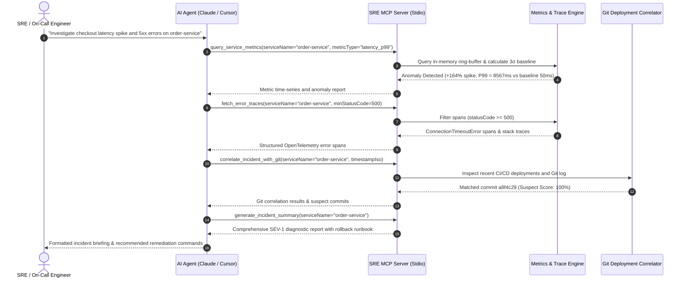

# ⚡ Autonomous SRE & Distributed Incident Diagnosis MCP Server

[](https://www.typescriptlang.org/)
[](https://nodejs.org/)
[](https://opentelemetry.io/)
[](https://modelcontextprotocol.io/)
[](https://opensource.org/licenses/MIT)

An autonomous, production-grade **Model Context Protocol (MCP)** server built in TypeScript that equips AI agents with site reliability engineering (SRE) capabilities: distributed telemetry analysis, dynamic $3\sigma$ statistical anomaly detection, OpenTelemetry error trace indexing, and automated Git deployment root-cause correlation.

---

## 🏗️ Architecture & Interaction Flow

The server connects AI host applications (Claude Desktop, Cursor, Antigravity) via clean JSON-RPC over `stdio`. Internal diagnostics and logging are routed strictly through `stderr` and `server.log` to preserve JSON-RPC protocol framing integrity on `stdout`.



---

## 🛠️ MCP Tools Reference

### 1. `query_service_metrics`
Queries time-series telemetry metrics and performs statistical anomaly detection ($3\sigma$ standard deviation dynamic bounds and SLA critical threshold checks).

* **Zod Parameters:**
  ```typescript
  {
    serviceName: z.string().describe('Target microservice name (e.g. "order-service")'),
    metricType: z.enum(['cpu', 'memory', 'error_rate', 'latency_p99']),
    timeframeMinutes: z.number().min(1).max(180).optional().default(15)
  }
  ```
* **Sample Output:**
  ```json
  {
    "serviceName": "order-service",
    "metricType": "latency_p99",
    "timeframeMinutes": 15,
    "unit": "ms",
    "summary": {
      "current": 8567.16,
      "min": 48.2,
      "max": 8939.52,
      "avg": 2840.11,
      "p95": 8750.32,
      "p99": 8939.52,
      "baselineMean": 50,
      "baselineStdDev": 3412.5,
      "unit": "ms"
    },
    "anomaliesDetected": [
      {
        "timestamp": "2026-11-11T06:19:48.938Z",
        "metricType": "latency_p99",
        "value": 8567.16,
        "baselineMean": 50,
        "threshold": 1000,
        "severity": "critical",
        "spikePercentage": 17034,
        "description": "CRITICAL: latency_p99 reached 8567.16ms (+17034% deviation from baseline mean 50ms)"
      }
    ],
    "dataPoints": [...]
  }
  ```

---

### 2. `fetch_error_traces`
Retrieves structured OpenTelemetry-compliant error spans with stack traces, endpoints, HTTP methods, and execution durations.

* **Zod Parameters:**
  ```typescript
  {
    serviceName: z.string().describe('Target microservice name (e.g. "order-service")'),
    minStatusCode: z.number().optional().default(500),
    timeframeMinutes: z.number().optional().default(30),
    limit: z.number().optional().default(10)
  }
  ```
* **Sample Output:**
  ```json
  {
    "serviceName": "order-service",
    "minStatusCode": 500,
    "timeframeMinutes": 30,
    "summary": {
      "totalMatchingSpans": 6,
      "impactedEndpoints": { "/api/v1/orders/checkout": 6 },
      "statusCodeDistribution": { "500": 6 },
      "commonExceptions": [
        {
          "type": "ConnectionTimeoutError",
          "count": 6,
          "sampleMessage": "TimeoutError: ResourcePool timed out after 8000ms acquiring client connection. Max pool size (20) reached. Active clients: 20, Waiting clients: 74."
        }
      ]
    },
    "spans": [
      {
        "traceId": "839b433d68c2cf08849ed653cfffac66",
        "spanId": "e39d4f2f188411fe",
        "endpoint": "/api/v1/orders/checkout",
        "httpMethod": "POST",
        "statusCode": 500,
        "durationMs": 8505,
        "errorMessage": "TimeoutError: ResourcePool timed out after 8000ms acquiring client connection. Max pool size (20) reached.",
        "stackTrace": "TimeoutError: ResourcePool timed out after 8000ms acquiring client connection...\n    at Pool.acquire (src/database/connectionPool.ts:142:19)",
        "attributes": {
          "db.system": "postgresql",
          "db.pool.max": 20,
          "db.pool.active": 20,
          "db.pool.waiting": 74
        }
      }
    ]
  }
  ```

---

### 3. `correlate_incident_with_git`
Correlates an incident detection timestamp with CI/CD deployment history and Git logs to identify suspect commits with an automated **Suspect Confidence Score** (0–100%).

* **Zod Parameters:**
  ```typescript
  {
    timestampIso: z.string().describe('ISO 8601 timestamp of incident peak or detection'),
    serviceName: z.string().describe('Target microservice name'),
    windowMinutes: z.number().optional().default(60)
  }
  ```
* **Sample Output:**
  ```json
  {
    "serviceName": "order-service",
    "incidentTimestamp": "2026-11-11T06:19:48.957Z",
    "analysisWindowMinutes": 60,
    "totalCommitsInspected": 3,
    "highestSuspect": {
      "sha": "a8f4c2918e7d45bb921c320e82aa619f7bc014a9",
      "shortSha": "a8f4c29",
      "author": "Alex Dev",
      "email": "alex.dev@corp.io",
      "timestamp": "2026-11-11T06:05:48.957Z",
      "message": "perf(db): downscale connection pool max size to 20 to reduce idle postgres overhead",
      "changedFiles": [
        "src/database/connectionPool.ts",
        "config/production.json",
        "k8s/order-service-deployment.yaml"
      ],
      "suspectScore": 100,
      "suspectReasons": [
        "Deployed 14 minutes before incident onset",
        "Modified database connection pool settings (src/database/connectionPool.ts)",
        "Directly reduced max resource pool capacity",
        "Modified sensitive database/network infrastructure files"
      ]
    },
    "correlationSummary": "High correlation found: Commit a8f4c29 (\"perf(db): downscale connection pool max size to 20...\") by Alex Dev deployed ~14m before incident (Suspect Score: 100%)."
  }
  ```

---

### 4. `generate_incident_summary`
Synthesizes telemetry metrics, OpenTelemetry spans, and Git diffs into an actionable **SEV-1 / SEV-2 Diagnostic Report** and immediate mitigation runbook.

* **Zod Parameters:**
  ```typescript
  {
    serviceName: z.string().describe('Primary microservice affected by the incident'),
    incidentTimestampIso: z.string().optional().describe('Incident timestamp (defaults to now)'),
    lookbackMinutes: z.number().optional().default(30)
  }
  ```
* **Sample Output:**
  ```json
  {
    "incidentTitle": "Incident in order-service - SEV-1 (CRITICAL)",
    "severity": "SEV-1 (CRITICAL)",
    "serviceName": "order-service",
    "rootCauseHypothesis": "Database connection pool starvation. Active connections saturated the configured limit, leading to client acquisition timeouts (HTTP 500) and cascading request backpressure. Strongly correlated with deployment of commit a8f4c29 which altered connection pool sizing.",
    "remediationSteps": [
      "Trigger immediate rollback of deployment: `git revert a8f4c29 && git push origin main`",
      "Or roll back Kubernetes deployment revision: `kubectl rollout undo deployment/order-service`",
      "Temporarily scale up database pool size in environment config (e.g. `DB_POOL_MAX=50`)."
    ],
    "postMortemActions": [
      "Implement PgBouncer or AWS RDS Proxy connection pooling layer.",
      "Add Prometheus connection pool saturation alert at 80% capacity utilization.",
      "Audit long-running database queries and missing transaction commit/rollback calls."
    ],
    "diagnosticMarkdown": "# 🚨 INCIDENT DIAGNOSTIC REPORT: ORDER-SERVICE..."
  }
  ```

---

### 5. `simulate_incident_event`
Injects synthetic distributed incident scenarios for automated chaos testing and evaluation.

* **Zod Parameters:**
  ```typescript
  {
    serviceName: z.string().describe('Target service name (e.g. "order-service")'),
    incidentType: z.enum([
      'db_connection_pool_exhaustion',
      'high_5xx_spike',
      'memory_leak',
      'cpu_throttling'
    ]),
    severity: z.enum(['warning', 'critical']).optional().default('critical')
  }
  ```

---

## ⚡ Quick Start

### Prerequisites
- Node.js $\ge$ 20.0.0
- npm $\ge$ 10.0.0

### Installation & Build
```bash
# Clone the repository
git clone https://github.com/thedailyhub31-blip/autonomous-sre-mcp-server.git
cd autonomous-sre-mcp-server

# Install dependencies
npm install

# Build TypeScript to dist/
npm run build
```

### Running the Test Suite
The repository includes an automated end-to-end test client running against the compiled MCP server over stdio:
```bash
npm test
```

### Starting the Server
```bash
npm start
```

---

## 💻 Client Configuration

### Claude Desktop
Add this to your `claude_desktop_config.json`:
```json
{
  "mcpServers": {
    "sre-server": {
      "command": "node",
      "args": [
        "/absolute/path/to/autonomous-sre-mcp-server/dist/index.js"
      ]
    }
  }
}
```

### Cursor IDE
Add to `.cursor/mcp.json` or through Cursor Settings $\rightarrow$ Features $\rightarrow$ MCP:
```json
{
  "mcpServers": {
    "sre-incident-diagnosis": {
      "command": "node",
      "args": [
        "/absolute/path/to/autonomous-sre-mcp-server/dist/index.js"
      ]
    }
  }
}
```

---

## 🛡️ License

Distributed under the [MIT License](LICENSE). Copyright (c) 2026 thedailyhub31-blip.
